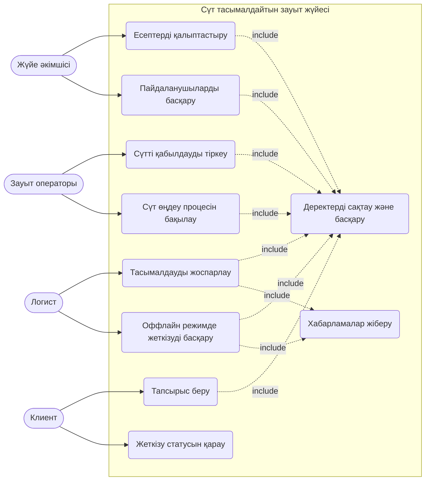

# Use Case сипаттамасы

## Актерлер
- **Клиент:** тапсырыс береді, жеткізу статусын қарайды.
- **Зауыт операторы:** сүтті қабылдауды тіркейді, өңдеу процесін бақылайды.
- **Логист:** тасымалдауды жоспарлайды, оффлайн режимде жеткізуді басқарады.
- **Жүйе әкімшісі:** пайдаланушыларды басқарады, есептерді қалыптастырады.

